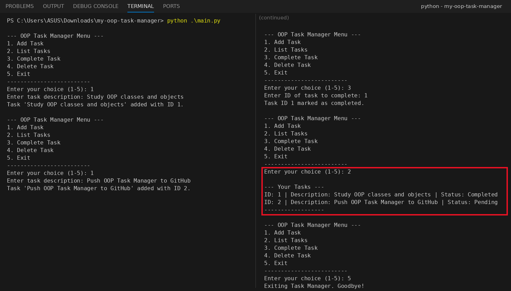

# Week 8: Object-Oriented Programming (OOP) Fundamentals & Refactoring the CLI Task Manager

ผู้จัดทำ: เมธาวี สิทธิชัยเนตร, รหัสนักศึกษา 663380372-6

**My OOP Task Manager CLI** เป็นโปรแกรมจัดการงานผ่าน command line ปรับจาก Week 7 แบบ procedural มาเป็น **OOP** โดยใช้คลาส `Task` และ `TaskManager`

## 📸 Screenshot: List Tasks (1 Completed + 1 Pending)
รันตามขั้นตอนของ lab ดังนี้
1. Add Task 2 งาน
2. Complete Task ID 1
3. List Tasks



```
--- Your Tasks ---
ID: 1 | Description: Study OOP classes and objects | Status: Completed
ID: 2 | Description: Push OOP Task Manager to GitHub | Status: Pending
------------------
```

## Features
* **Add Tasks**: เพิ่มงานพร้อมคำอธิบาย ได้ ID อัตโนมัติ
* **List Tasks**: แสดงงานทั้งหมด (ID, Description, Status) ผ่าน `Task.__str__`
* **Complete Tasks**: ทำเครื่องหมายว่าเสร็จด้วย ID (`task.mark_complete()`)
* **Delete Tasks**: ลบงานด้วย ID
* **Persistence**: บันทึกลง `data/tasks.json` และโหลดอัตโนมัติตอนเปิดโปรแกรม

## OOP Design
* **`Task` class** (`src/task.py`)
  * Attributes: `id`, `description`, `completed`
  * Methods: `__init__`, `mark_complete()`, `to_dict()` (สำหรับบันทึก JSON), `__str__` (สำหรับผู้ใช้), `__repr__` (สำหรับ debug)
* **`TaskManager` class** (`src/task_manager.py`)
  * Attributes: `self.tasks` (list ของ `Task`), `self.next_id`, `self.data_file`
  * Methods: `add_task()`, `list_tasks()`, `complete_task()`, `delete_task()`
  * Internal methods: `_load_tasks()` (แปลง dict เป็น `Task`), `_save_tasks()` (แปลง `Task` เป็น dict)

## How to Run
```bash
git clone https://github.com/punchyayaho/<repo-name>.git
cd <repo-name>
python main.py
```
ใช้แค่ Python standard library จึงไม่ต้องติดตั้งอะไรเพิ่ม

## Project Structure
```
my-oop-task-manager/
├── src/
│   ├── __init__.py       # Makes 'src' a Python package
│   ├── task.py           # Defines the Task class
│   └── task_manager.py   # Defines the TaskManager class (core logic + data)
├── data/
│   └── tasks.json        # Stores your tasks (created automatically)
├── screenshots/
│   └── list_all_tasks.png
├── main.py               # Main entry point, handles CLI interaction
├── .gitignore
└── README.md
```

## สิ่งที่แก้จาก starter code
`main.py` เดิมเพิ่ม `src/` ลงใน `sys.path` แล้วใช้ `from task_manager import TaskManager` แต่ `task_manager.py` ใช้ relative import (`from .task import Task`) ทำให้รันแล้วเจอ `ImportError: attempted relative import with no known parent package` จึงแก้เป็น `from src.task_manager import TaskManager` โดยเพิ่มโฟลเดอร์โปรเจกต์ลงใน path แทน
